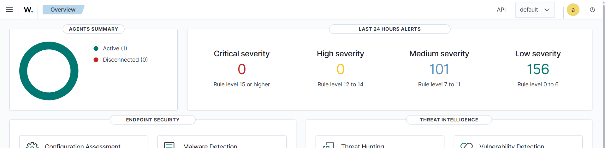
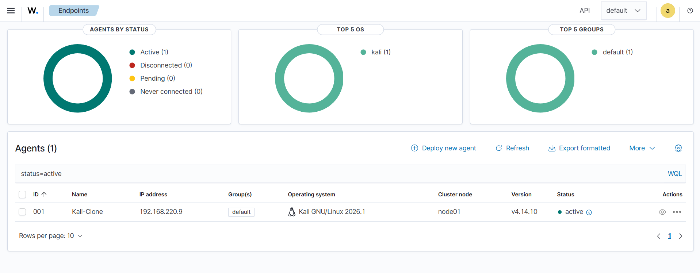
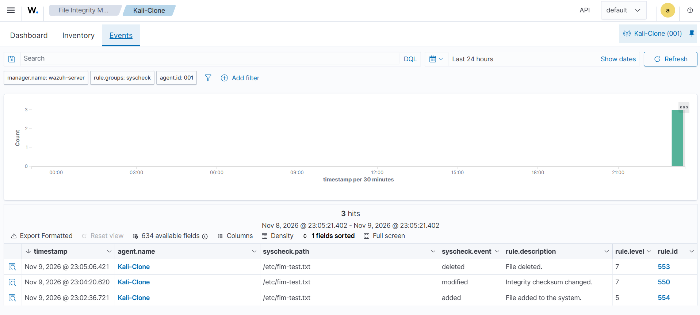
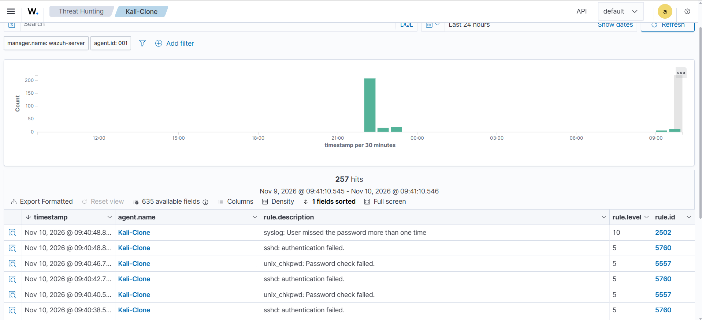
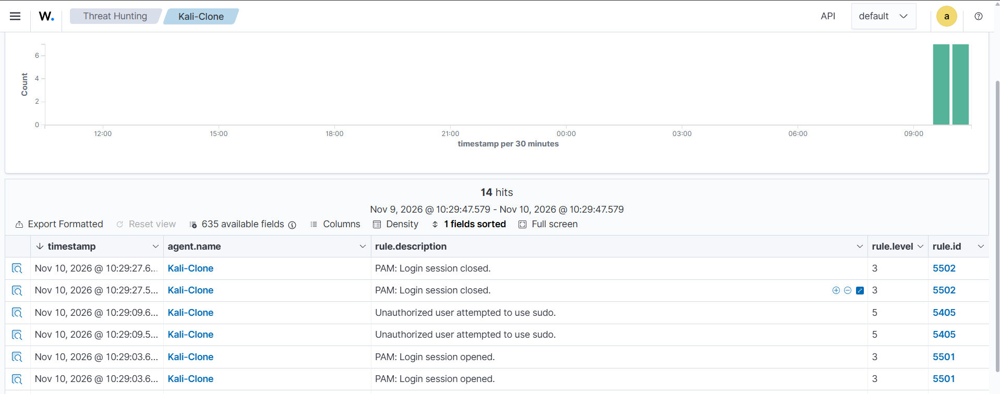

# Wazuh SIEM Home Lab – Linux Security Monitoring

## Project Overview

This project demonstrates the deployment and configuration of Wazuh SIEM in a virtualized lab environment using Oracle VirtualBox.

A Wazuh 4.14.10 server was deployed as the central monitoring platform, while Kali Linux 2026.1 was configured as the monitored endpoint using the Wazuh agent.

The project focuses on centralized log collection, endpoint monitoring, File Integrity Monitoring (FIM), authentication monitoring, and security event investigation.

## Lab Environment

| Component | Details |
|---|---|
| SIEM Platform | Wazuh 4.14.10 |
| Server | Wazuh OVA |
| Endpoint | Kali Linux 2026.1 |
| Virtualization | Oracle VirtualBox |
| Agent Name | Kali-Clone |
| Agent ID | 001 |

## Implementation and Testing

### 1. Wazuh Server and Agent Setup
- Deployed Wazuh Server using the official OVA.
- Installed and configured the Wazuh agent on Kali Linux.
- Connected the endpoint to the Wazuh manager.
- Verified agent connectivity through the dashboard.

### 2. File Integrity Monitoring (FIM)
Configured monitoring for the `/etc` directory and tested file creation, modification, and deletion.

| Rule ID | Event | Level |
|---|---|---|
| 554 | File added | 5 |
| 550 | Integrity checksum changed | 7 |
| 553 | File deleted | 7 |

### 3. SSH Authentication Monitoring
- Monitored SSH authentication failures.
- Performed controlled repeated failed-login testing using Hydra.
- Investigated authentication-related alerts.

### 4. Unauthorized Sudo Activity
- Configured collection of `/var/log/auth.log`.
- Performed an unauthorized sudo attempt using a test account.
- Identified the resulting Wazuh alert.

**Rule ID:** 5405 – Unauthorized user attempted to use sudo (Level 5).

## Screenshots and Evidence

### Wazuh Dashboard

### Connected Kali Linux Agent

### File Integrity Monitoring

### SSH Authentication Monitoring

### Unauthorized Sudo Activity

## Skills and Tools

- Wazuh SIEM
- Linux Administration
- Security Event Monitoring
- Log Analysis
- File Integrity Monitoring
- SSH Authentication Monitoring
- Incident Investigation
- Kali Linux
- Oracle VirtualBox
- Hydra

## Project Documentation

The complete project report is available here:

[**View Wazuh SIEM Project Report (PDF)**](documentation/Wazuh_Report_Jerrit.pdf)

## Key Learnings

- Deploying and configuring a SIEM platform.
- Connecting and monitoring Linux endpoints.
- Collecting and analyzing authentication logs.
- Detecting file integrity changes.
- Investigating authentication and privilege-related events.
- Understanding Wazuh rule IDs and alert severity levels.

## Author

**Jerrit Joseph Vadakkel**

B.Tech – Computer Science and Engineering (Cyber Security)
